<div align="center">

# ◉ SiteRadar

**Radar de prospecção para quem vende sites a negócios locais.**
Encontra as empresas perto de você, mostra onde cada uma está perdendo clientes na internet e já entrega a mensagem certa para começar a conversa.

*Projeto pessoal · em uso por uma equipe pequena de prospecção em São Paulo*

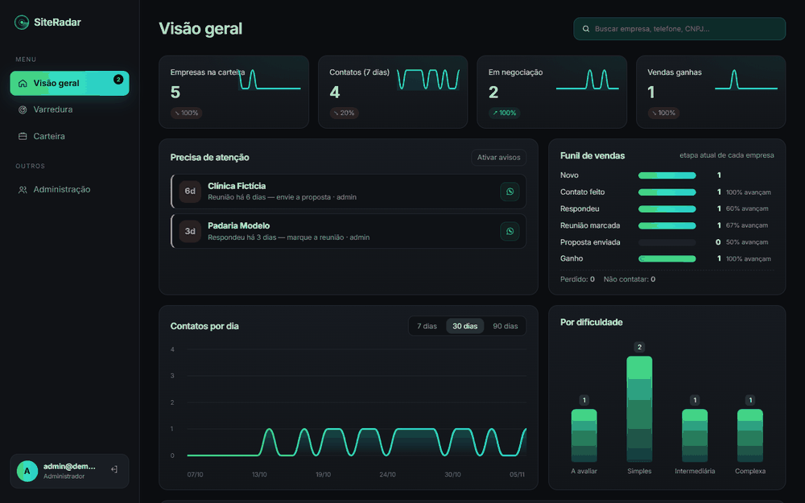

</div>

---

## Por que eu criei

Quem faz sites para pequenos negócios perde muito tempo descobrindo **quem** abordar e **o que** dizer. A maioria das padarias, oficinas, clínicas e salões do bairro não tem site, ou tem um site que não abre bem no celular, e mesmo assim o primeiro contato costuma ser genérico ("faço sites, tem interesse?").

O SiteRadar nasceu para resolver isso de ponta a ponta:

1. **Achar** as empresas mais próximas de quem está prospectando, não "São Paulo inteira".
2. **Diagnosticar** a presença digital de cada uma: tem site? abre no celular? tem WhatsApp? o rodapé é de 2016?
3. **Traduzir** isso para a dor do dono ("a clínica perde agendamentos para quem responde primeiro no WhatsApp").
4. **Facilitar o contato** com mensagem pronta, follow-up e respostas para objeções.
5. **Organizar a equipe**: quem falou com quem, em que etapa está cada negociação e quem está parado há dias.

Tudo com **custo zero de operação**, usando só fontes de dados abertas e planos gratuitos.

## O que ele faz

| | |
|---|---|
| 📍 **Varredura por raio** | Usa a localização real do aparelho (ou o endereço digitado) e lista as empresas no raio escolhido, de 1 a 500 km. No celular é um toque só: os 5 km em volta do aparelho, sem mapa, para usar na rua. |
| 🇧🇷 **Brasil inteiro por categoria** | 4,5 milhões de empresas do país. Escolha "provedor de internet", "padaria", "oficina"… e a lista vem do mais perto ao mais longe (ex.: os 7 mil provedores do Brasil em segundos). |
| 🏷️ **Busca por categoria** | Filtra os resultados por tipo de negócio, cruzando a categoria do mapa com a atividade oficial do CNPJ (CNAE). |
| 🔎 **Diagnóstico do site** | Visita a página inicial (com proteção contra SSRF) e aponta: sem HTTPS, não responsivo, sem WhatsApp/telefone clicável, lento, desatualizado, ou "site" que é só Instagram/Linktree. |
| 🤖 **Resumo com IA** | Gera risco de perda, manchete, perdas por impacto, mensagem de abertura, follow-up, respostas a objeções e próximo passo, seguindo o roteiro "dor → consequência → solução → convite". A IA recebe só sinais técnicos, nunca dados pessoais. |
| 💬 **Contato em 1 toque** | Botões de WhatsApp (com a mensagem pronta), ligar, e-mail, site, Instagram, Facebook, Google Maps e rota. Ao voltar do WhatsApp, o site pergunta "Você enviou a mensagem?" e só registra o contato com a confirmação (nada de funil inflado por clique). |
| 💰 **Sugestões e preço base** | 31 itens em 5 grupos e pacotes prontos (Essencial, Profissional, Completo). Calcula horas × valor da hora × tecnologia, com mensal separado e premissas na proposta. |
| 📅 **Agenda da equipe** | Calendário de reuniões, visitas e ligações. Ao agendar pela ficha, leva junto só os itens da proposta escolhidos. |
| 🧭 **Funil e follow-up** | Etapas em linha do tempo clicável, funil de vendas, alerta de contatos parados há 2–5 dias e notificação no navegador. |
| 👥 **Equipe e administração** | Acesso só por convite. Quem tenta entrar sem autorização vira um pedido no sininho do admin (autorizar/recusar na hora). Sessões por aparelho com "online agora" e locais de entrada agrupados. |
| 📱 **PC e celular** | Layout responsivo pensado para usar na rua, no celular. |

<div align="center">

</div>

## Telas

| Computador | Celular |
|---|---|
| 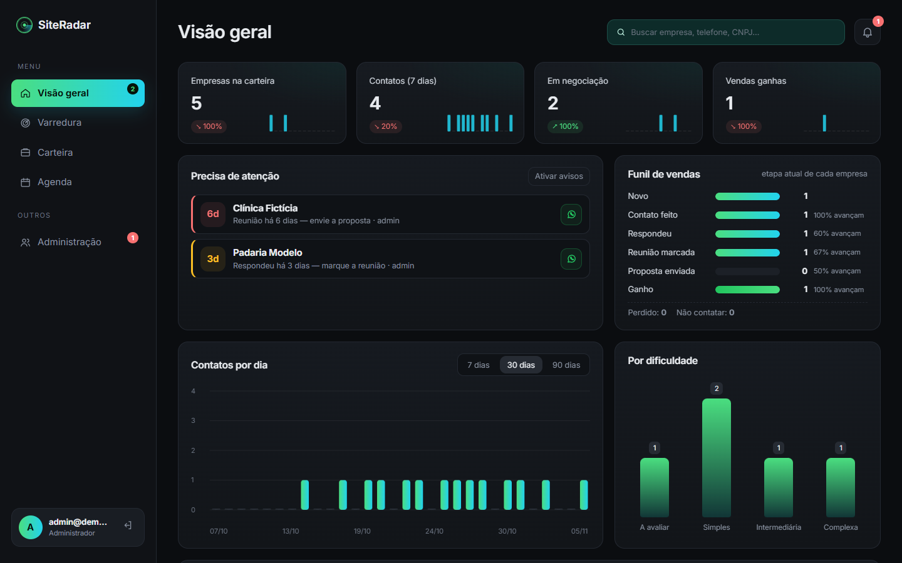 | 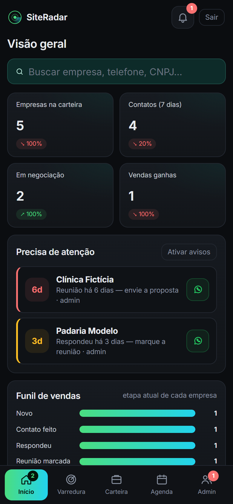 |
| 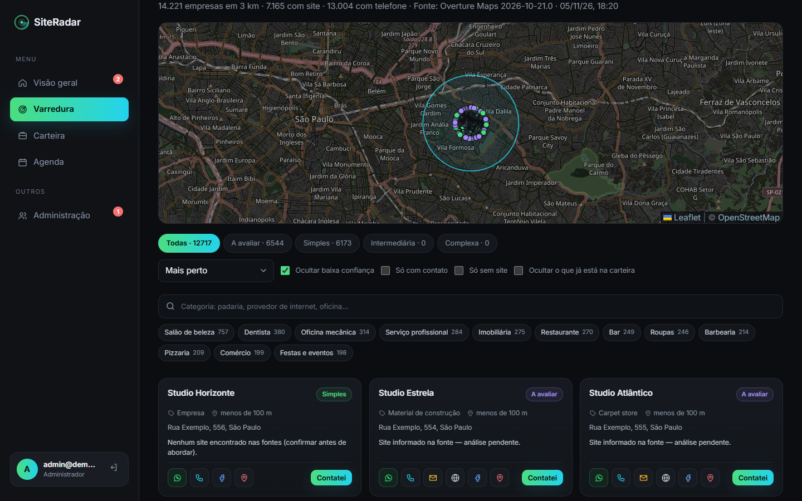 | 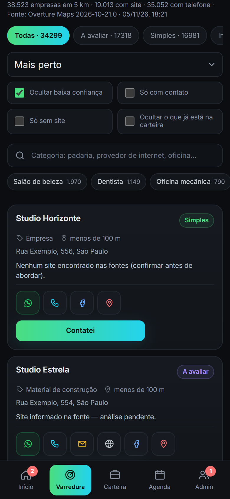 |
| 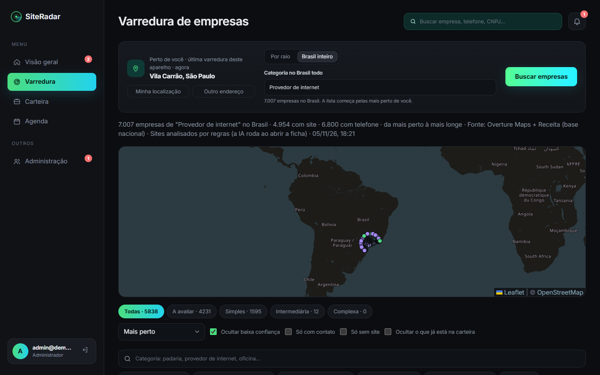 | 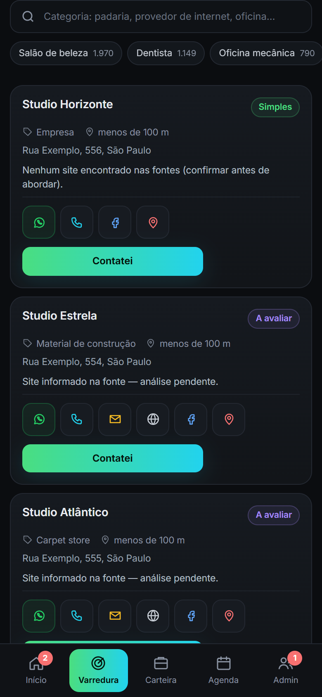 |
| 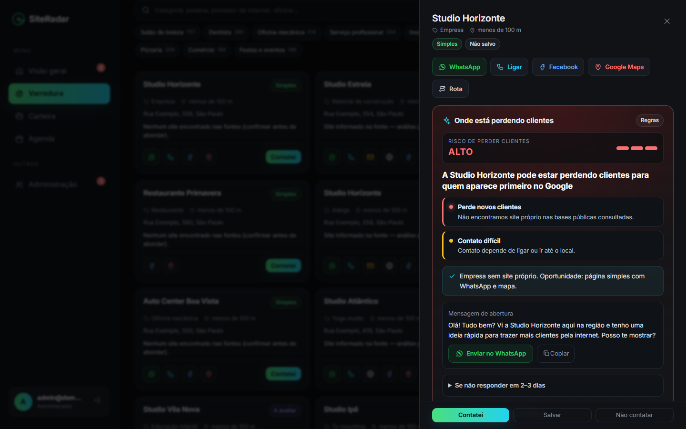 | 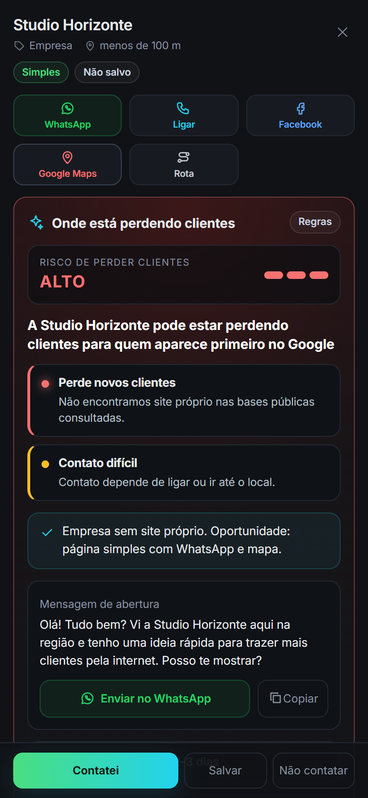 |
| 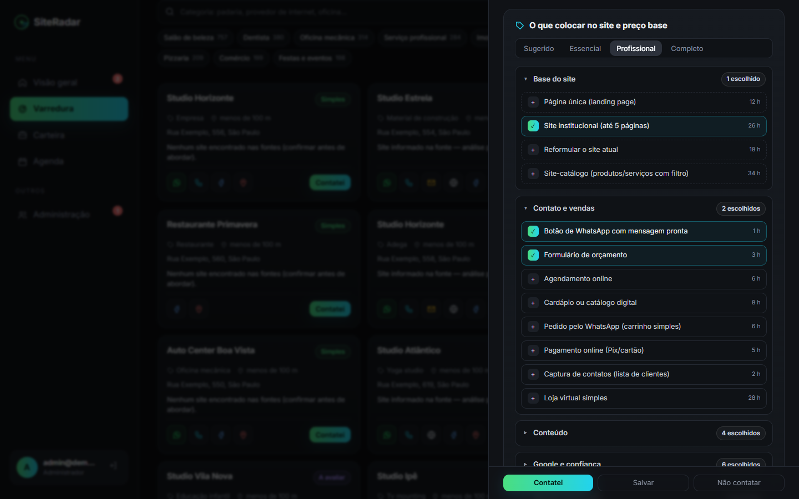 | 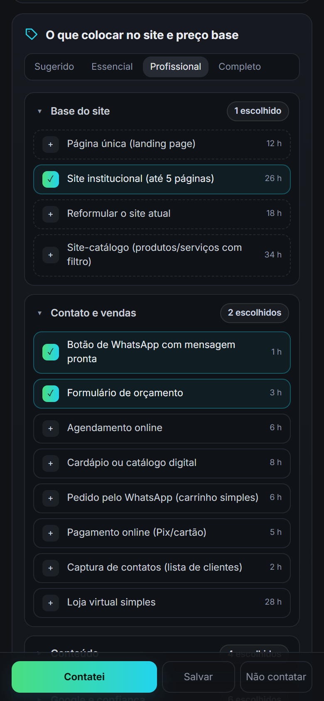 |
| 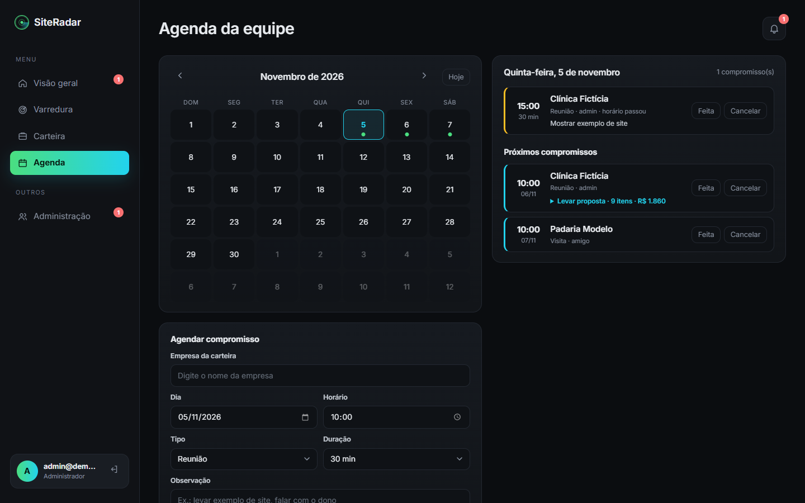 |  |
| 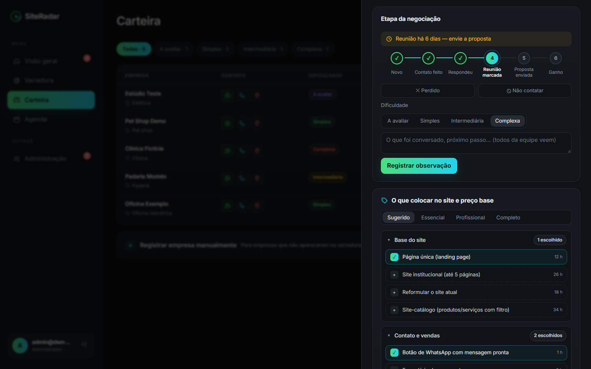 | 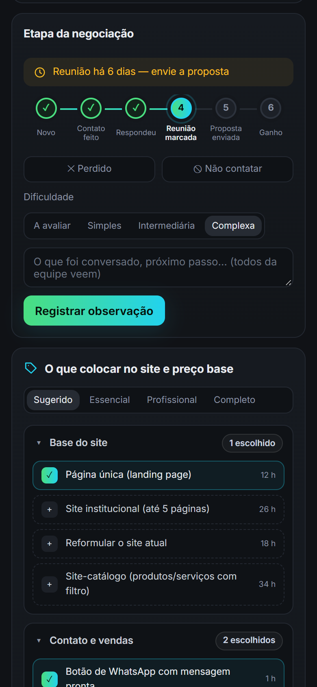 |
| 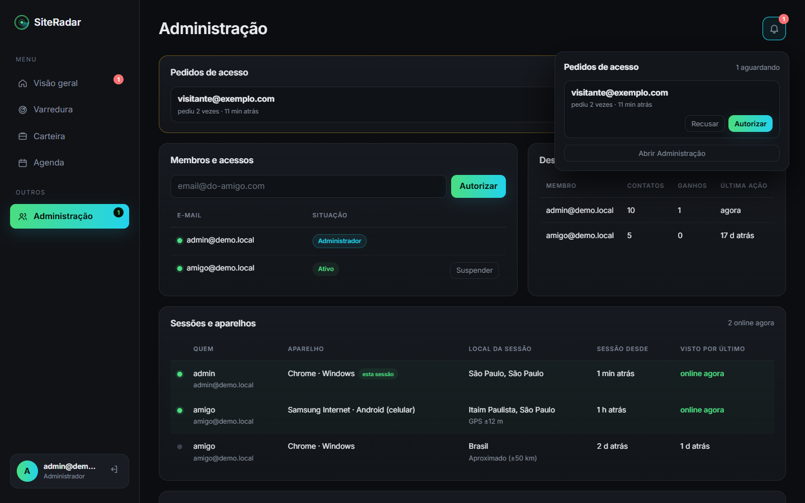 | 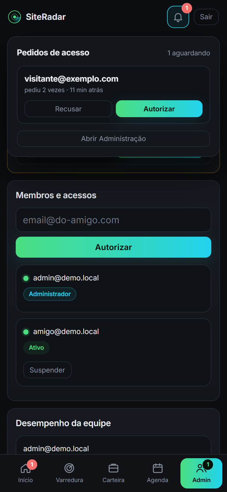 |
| 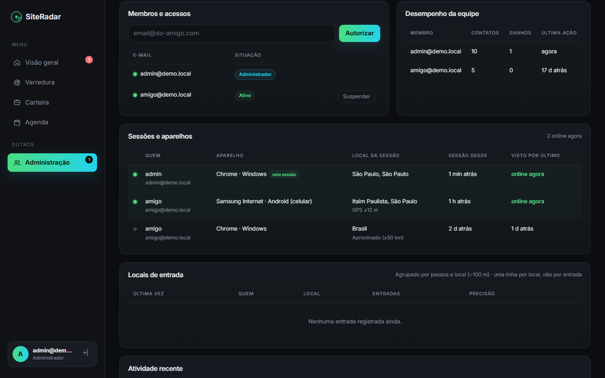 | 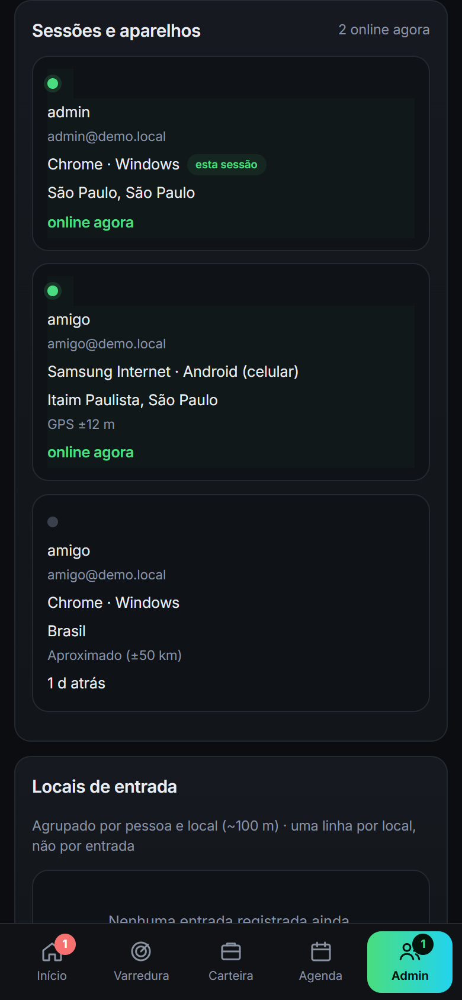 |

> Os prints usam o **modo demonstração**: nomes, endereços e contatos das empresas foram trocados por dados fictícios.

## Tecnologias

**Front-end**
- HTML, CSS e **JavaScript puro** (ES Modules), sem framework, renderizando só com `textContent` (sem `innerHTML`)
- **Leaflet** para o mapa, com tiles do OpenStreetMap em tema escuro
- Fonte **Inter** embutida; gráficos e minigráficos em SVG feitos à mão
- PWA-friendly, com layout mobile-first ajustado para Android (Galaxy S23)

**Back-end (serverless)**
- **Supabase**: Postgres com **Row Level Security** em todas as tabelas, Auth com link mágico e **Edge Functions em Deno/TypeScript**
- Funções `SECURITY DEFINER` com `search_path` vazio para escrita validada (registrar contato, check-in de local, excluir empresa)
- **OpenRouter** (`openrouter/free`) com saída em JSON, novas tentativas e leitura tolerante a respostas cortadas

**Dados (todos abertos e gratuitos)**
- **Overture Maps Places**: **4,5 milhões de empresas do Brasil inteiro**, atualizadas mensalmente, lidas com **DuckDB** direto do S3
- **Receita Federal (Dados Abertos CNPJ)**: 28 milhões de estabelecimentos ativos cruzados por telefone e por CEP + número + similaridade de nome (Jaro-Winkler): ~850 mil empresas com CNPJ, CNAE e data de abertura
- **OpenStreetMap / Photon** como reserva fora da base, **BrasilAPI** para checar o CNPJ ao vivo

**Infra e DevOps**
- **Cloudflare Pages**: site estático com a base nacional em ~15 mil arquivos (por região, em blocos de 0,5°, e por categoria, em quadrados de até 5 MB), lidos sob demanda e do mais perto ao mais longe, sem limite de consultas
- **Brevo (SMTP)** para os e-mails de acesso, com modelo próprio do SiteRadar
- Build em Node com CSP restrita, HSTS e versão nos arquivos para furar o cache; deploy com **Wrangler**
- Testes com `node:test` (varredura, IA, segurança da análise de sites, verificação de CNPJ)

## Arquitetura

```
Celular / PC ──► Cloudflare Pages (site estático + base de empresas em quadrados JSON)
     │
     ├──► Supabase Auth (link mágico, só convidados)
     ├──► Supabase Postgres + RLS (carteira, etapas, histórico, check-ins)
     └──► Edge Functions (Deno)
             ├─ analyze-sites → visita o site (anti-SSRF) + OpenRouter (IA gratuita)
             ├─ verify-company → BrasilAPI (CNPJ)
             └─ authorize-member → convites do administrador

PC (1x por mês) ─► DuckDB ─► Overture Maps (S3) + Receita Federal ─► arquivos da base ─► Cloudflare
```

## Decisões que valeram a pena

- **Base própria em vez de API com limite.** As APIs públicas de mapas bloqueavam ou limitavam rápido. Gerar a base da região uma vez por mês e servir como arquivos estáticos deixou tudo grátis e instantâneo para a equipe.
- **IA com o mínimo de dados.** O modelo recebe categoria e sinais técnicos (tem HTTPS? tem WhatsApp?), nunca nome, telefone ou texto do site. Isso reduz o risco de vazamento e de *prompt injection*.
- **"Site" que é só Instagram conta como sem site.** Esse detalhe transformou milhares de empresas em oportunidades claras de landing page.
- **Segurança por padrão.** RLS em tudo, cadastro público desligado, um único administrador e Edge Functions que validam o usuário antes de qualquer ação.

## Status

Em uso pela equipe. O código-fonte é privado; este repositório é a vitrine do projeto.

---

<div align="center">
Feito por <b>Luan Thierry</b> · ideias, dúvidas ou parcerias: chama no LinkedIn
</div>
